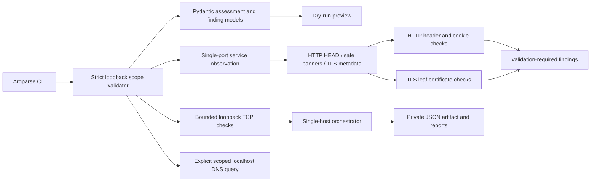

# NetProbe

NetProbe is a Python command-line tool for documenting and validating **authorized local-lab assessments**. The current implementation provides strict loopback-only scope validation, bounded TCP connect checks, limited service observations, validation-required HTTP/TLS findings, one-host assessment orchestration, explicit reserved-name DNS queries to a scoped loopback resolver, and JSON/CSV/HTML reporting.

> **Boundary:** This release only checks selected TCP ports on one host per invocation and is restricted in code to `localhost`, IPv4 loopback (`127.0.0.0/8`), and IPv6 loopback (`::1/128`). Private LANs and public hosts are rejected, including when listed in an authorization file.

## Features and non-goals

- YAML scope files with an explicit authorization acknowledgment and exclusions.
- Strict target parsing and containment checks before network activity.
- Pydantic data models and a transparent prioritization score kept separate from CVSS.
- `validate-scope`, `assess`, `scan`, `enumerate`, `check-http`, `dns-check`, `report`, and `version` CLI commands.
- Async TCP connect checks, bounded to 16 concurrent connections, 64 unique ports, and a five-second maximum timeout. Dry-run validates all these same bounds and never opens sockets.
- `common` and `web` port profiles; explicit comma-separated ports and ranges.
- No credentials, authentication attempts, packet crafting, or exploit checks.

Host discovery and DNS record enumeration beyond explicit A/AAAA/MX/NS/TXT lookups for `localhost` or reserved `.test` names are not implemented. TLS reports leaf certificate subject/issuer, dates, SANs, and literal IP-SAN match; it does not validate trust chains or DNS hostnames. `assess` is limited to one loopback target and selected ports. HTTP/TLS leads require validation and are not proof of exploitability. Cookie values and redirect locations are not retained. Reports cover assessment artifacts with limitations stated.

## Installation

Requires Python 3.12+. From a checkout, create a virtual environment and install the package:

    python3.12 -m venv .venv
    . .venv/bin/activate
    python -m pip install --upgrade pip
    python -m pip install -e '.[dev]'

On Windows, activate with `.venv\\Scripts\\activate`.

## Quick start

    netprobe validate-scope --scope examples/scope.example.yaml
    netprobe assess --scope examples/scope.example.yaml --dry-run
    netprobe scan --scope examples/scope.example.yaml --target 127.0.0.1 --ports 22,80,443 --dry-run
    netprobe scan --scope examples/scope.example.yaml --target 127.0.0.1 --ports 22,80,443 --i-have-authorization
    netprobe enumerate --scope examples/scope.example.yaml --target 127.0.0.1 --port 8080 --protocol http --dry-run
    netprobe enumerate --scope examples/scope.example.yaml --target 127.0.0.1 --port 8080 --protocol http --i-have-authorization
    netprobe check-http --scope examples/scope.example.yaml --target 127.0.0.1 --port 8080 --dry-run
    netprobe check-http --scope examples/scope.example.yaml --target 127.0.0.1 --port 8080 --i-have-authorization
    netprobe assess --scope examples/scope.example.yaml --target 127.0.0.1 --ports 22,80,443 --dry-run
    netprobe assess --scope examples/scope.example.yaml --target 127.0.0.1 --ports 22,80,443 --i-have-authorization
    netprobe dns-check --scope examples/scope.example.yaml --server 127.0.0.1 --name lab.test --type A --dry-run
    netprobe report --assessment latest --format html
    netprobe version

The scope file must set `authorization_confirmed: true`. This is a record, not proof of legal authorization. A dry run validates scope and prints a preview only. Active scans also require the explicit acknowledgment flag. Connection refusal is reported as closed; timeouts and other socket errors are reported as unknown.

`check-http` and `assess` save private assessment records under `netprobe-data/assessments/`. `report` renders them as JSON, CSV, or escaped HTML under `netprobe-data/reports/`; existing reports are not replaced unless `--overwrite` is supplied. `dns-check` is a separate single explicit query and does not perform discovery or zone transfer. See [docs/walkthrough.md](docs/walkthrough.md) for the isolated end-to-end lab.

## Architecture

## Development

    python -m pytest
    ruff check .
    ruff format --check .
    mypy src/netprobe
    bandit -r src/netprobe

The lock file is generated with uv when available (`uv lock`). GitHub Actions will run deterministic tests and static checks.

## Supported platforms

The current Python implementation is intended for Linux, macOS, and Windows with Python 3.12+. It uses ordinary TCP connect behavior and no platform-specific packet operations.

## Limitations and safe use

NetProbe does not establish authorization and is not a substitute for written scope approval, change control, or professional validation. Port observations are not vulnerability findings. Never remove or bypass the loopback-only gate to assess a network. See [SECURITY.md](SECURITY.md) for reporting guidance.

## Current implementation status

- Phase 1: foundational packaging, data models, scope validation, CLI preview, and unit tests — complete.
- Phase 2: bounded loopback TCP connect scanner — partial; broad host discovery is not included.
- Phase 3: limited loopback service observation, leaf TLS certificate checks, and explicit reserved-name DNS queries — partial; trust-chain, DNS-hostname validation, and discovery remain unsupported.
- Phase 4: HTTP/TLS observation plugins with validation-required findings — partial; no exploit checks.
- Phase 5: private artifacts and JSON/CSV/HTML reports for one-host assessments — implemented with explicit coverage limits.
- Phase 6: tests, CI, Ruff, mypy, Bandit, Snyk Code/SCA, and package build — verified for this state.
- Phase 7: docs and local-lab walkthrough — updated; only loopback workflow is demonstrated.
